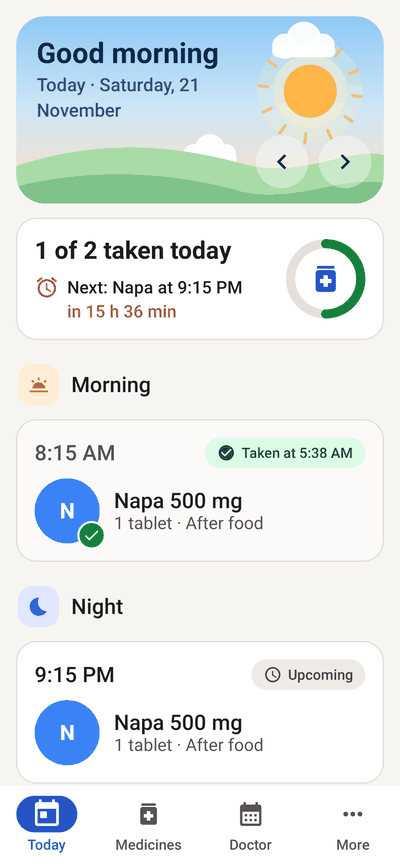
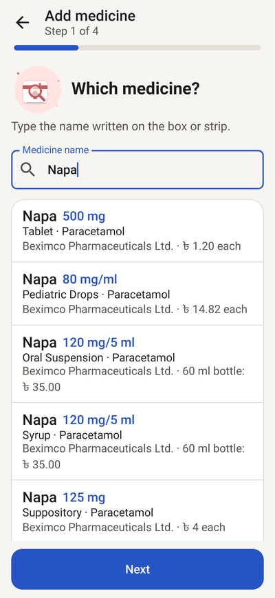
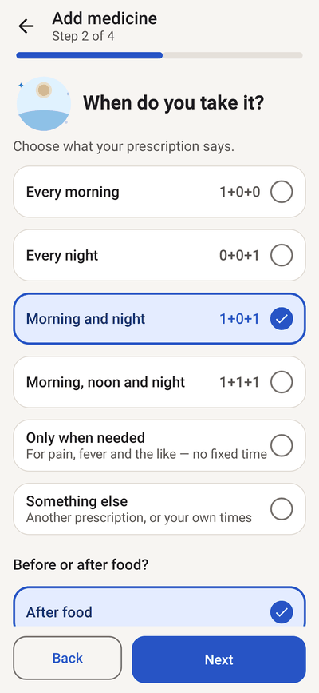
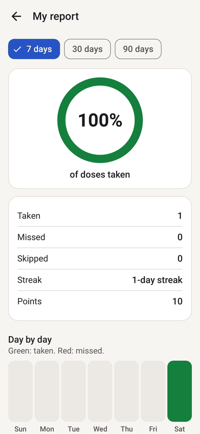
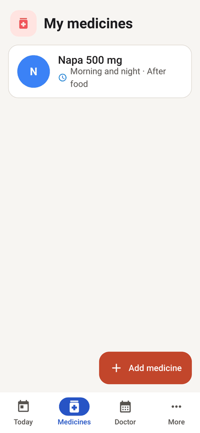
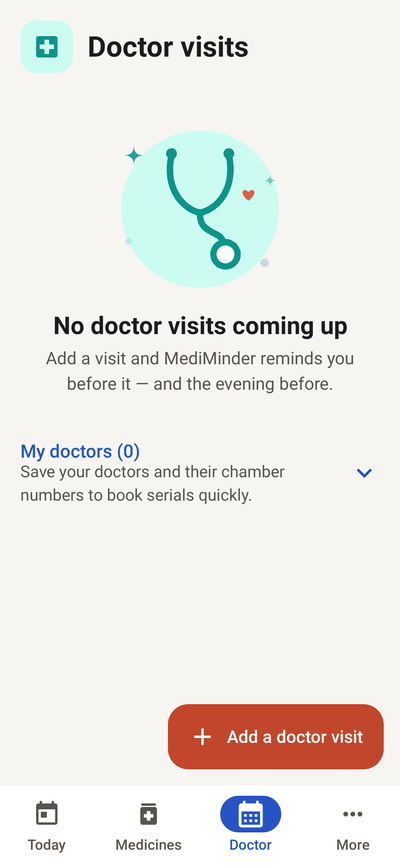
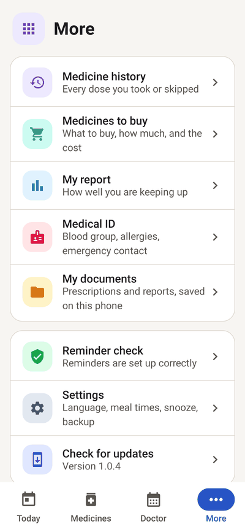
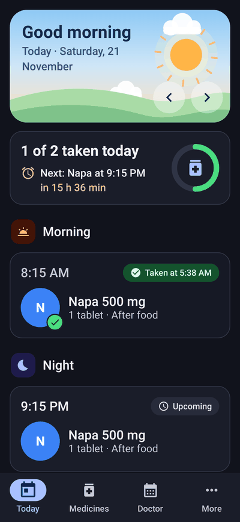

<div align="center">

# MediMinder

**Medicine reminders for Bangladesh, designed for older people.**
Gentle reminders or loud full-screen alarms that ring on time, in বাংলা and English.

[](https://github.com/irrepressible007/-MediMinder/releases/latest)
[](https://kotlinlang.org)
[](https://developer.android.com/compose)
[](https://github.com/irrepressible007/-MediMinder/releases/latest)






</div>

## Why

Many older people in Bangladesh take several medicines a day from prescriptions written as
"1+0+1, after food". Generic reminder apps get this wrong. Worse, popular phones (Xiaomi, Oppo,
Vivo, Realme…) quietly stop background apps, so a reminder that is set never rings.
MediMinder is built around both problems: it speaks the prescription's language, and it works
hard to make sure every alarm goes off.

## Features

**Reminders that ring**
- Exact alarms with an optional full-screen alarm over the lock screen; snooze, skip or Taken from
  the notification.
- Re-armed after reboot, app update, time or time-zone change, plus a 6-hourly safety net for
  phones that drop alarms.
- A *Reminder check* screen walks people through the phone's battery and permission settings.
- If a setting that reminders need is switched off, MediMinder says so in plain words and opens the
  exact settings page in one tap. It reminds gently and never blocks the app: a card on Today that
  can wait until tomorrow, a quiet notification at most every three days, and a note at the moment
  it matters, such as when choosing an alarm.

**Built for Bangladesh**
- An offline catalogue of **54,652 medicines** sold in Bangladesh (brand, generic, strength, form,
  maker and price), searchable by brand or generic name, or by **scanning the box** with the camera.
- Prescription patterns (1+0+0, 1+0+1, 1+1+1…) and before or after food. Dose times are worked out
  from the person's own meal times.
- Full Bangla and English, including Bangla digits.

**Creams, drops, inhalers and injections**
- Each is handled the way it is used: where a cream goes (knees, hands…), which eye, ear or
  nostril the drops are for, puffs for an inhaler, and insulin in units.
- Injection places can rotate (belly, thighs, upper arms in turn), and every reminder says where.
- Things that only last a few weeks once opened (eye drops, creams, syrups, inhalers) get a
  gentle "time for a new one" reminder.
- Reminders and buttons use the right words for each: a cream is *applied*, drops are *put in*;
  in Bangla লাগিয়েছি, দিয়েছি or নিয়েছি, never খেয়েছি for something that isn't swallowed.

**Health checks and habits**
- Write down blood pressure, blood sugar (mmol/L or mg/dL), weight, temperature (°F or °C) and
  oxygen. Each reading is labelled in plain words (normal, a bit high, high) using general adult
  ranges, with a clear warning when a reading is far outside them.
- Charts over time, with the usual range shaded, to show the doctor.
- Reminders to check at set times; answering one opens the page to write the reading down.
- Daily habits such as drinking water, walking, exercises, checking the feet (important with
  diabetes) and bedtime, with today's progress.

**Easy for older eyes and hands**
- Large text with a Text size setting, big touch targets, plain words, and high-contrast colours
  (WCAG AA).
- One tap for *Taken*, with **Undo** for a slip of the thumb, plus a countdown to the next dose.
- Multi-step tasks such as adding a medicine have a labelled **Cancel** that asks before discarding
  anything typed.
- Photos of the medicine's own box or strip, shown in reminders and alarms.
- Works on any screen: small phones from 320 dp wide, large phones, foldables and tablets (with a
  side rail on wide screens), in portrait or landscape, with text up to twice the normal size.

**Everything around the medicines**
- Medicine history, kept even after a medicine is deleted, and a report to share with a doctor
  or family: doses taken, habits kept, and health readings (latest and average).
- Stock counting with refill warnings, and a shopping list with prices.
- Doctor visits with reminders, a Medical ID (blood group, allergies, emergency contact) and a
  documents folder.
- Backup and restore to a file, and in-app updates from GitHub Releases.

**Friendly, alive interface**


Every screen has its own illustration, drawn in code. Each one traces itself like a pen drawing,
fills with colour, then keeps gently moving. Today opens on a sky that follows the real time of
day. All motion stops when the phone's *Remove animations* setting is on.

<p align="center">




</p>

## Tech stack

| Area | Used |
| --- | --- |
| Language | Kotlin 2.0 |
| UI | Jetpack Compose, Material 3, Navigation 3, custom Canvas illustrations |
| Architecture | MVVM with Hilt dependency injection, Kotlin coroutines and Flow |
| Data | Room (versioned migrations with schema tests), kotlinx.serialization for backups |
| Reminders | AlarmManager exact alarms, full-screen intents, WorkManager safety net |
| Camera and scanning | CameraX and ML Kit on-device text recognition |
| Images | Coil |
| Testing | JUnit, Robolectric, Compose UI tests (110 tests) |
| Delivery | GitHub Actions: build, signing with Android key rotation, release, update manifest |

## How it is built

```
app/src/main/java/com/example/mediminder/
├── data/        Room database, DAOs, repositories, backup, medicine catalogue, photos
├── domain/      Plain Kotlin logic: dose planning, prescription patterns, stock, adherence, safety checks,
│                care kinds, injection-site rotation, reading ranges
├── reminders/   The alarm engine, scheduler, notifications, full-screen alarm, system receivers
├── ui/          Compose screens, shared components, theme, motion and illustrations
├── updater/     In-app updates from GitHub Releases
└── util/        Formatting (Bangla digits), app language, problem log
```

A few decisions worth knowing:

- **The reminder engine is idempotent.** Each dose time has exactly one pending alarm. Re-arming
  everything is always safe, so it runs on every event that could have lost alarms.
- **Deleting a medicine can keep its history.** A soft delete keeps the dose records while the
  medicine disappears from every list and never rings again.
- **Illustrations are code, not images.** Each scene is drawn on a 100 × 100 grid with Compose
  Canvas and themed for light and dark mode. Every shape can be traced (drawing itself) or filled,
  which keeps the APK small.
- **Updates avoid GitHub's API.** The app reads `releases/latest/download/update.json`. GitHub's
  API allows only 60 anonymous requests an hour per internet address, which shared mobile
  connections use up quickly. The APK is checked against its size and SHA-256 before installing.
- **Signing uses Android key rotation (APK Signature Scheme v3).** No key is stored in this
  repository.
- **One model for everything that reminds.** A tablet, a cream, a blood-pressure check and a
  glass of water are all a `Medication` with a *kind*, so they share the alarm engine, history
  and reliability work. The kind decides only what is asked, how it is worded and how it is
  answered (a health check is answered by writing the reading down).
- **The app keeps its own problem log**, with crashes and caught failures. People can share it
  from Settings.

## Building

Requirements: Android Studio (JDK 17 or newer) and the Android SDK (compile SDK 36).

```bash
./gradlew assembleDebug        # install-ready debug build
./gradlew testDebugUnitTest    # unit, database, reminder-engine and UI tests (Robolectric)
./gradlew lintDebug            # Android Lint, kept at zero errors
```

**Release builds** need signing keys, which are not in this repository. Put them in a
`keystore.properties` file in the project root (it is git-ignored; see `tools/sign_release.py`
for the keys it expects) or in environment variables. Then:

```bash
./gradlew assembleRelease
python tools/sign_release.py   # adds the key rotation
```

**Medicine catalogue:** `python tools/build_catalogue.py` rebuilds
`app/src/main/assets/database/catalogue.db` from the sources in `medsdatabase/`.

## Releases

Pushing a tag such as `v1.0.5`, with the release notes as the tag's message, starts the release
workflow. It builds and signs the APK, then publishes it on
[Releases](https://github.com/irrepressible007/-MediMinder/releases) with an `update.json` that
installed apps use to offer the update.

## Roadmap

- Monthly catalogue updates delivered to the app without a new release.

## Data and disclaimer

The medicine catalogue is built from the Directorate General of Drug Administration (DGDA)
registered product lists and a public price list. MediMinder reminds and records; it does not give
medical advice. Always follow your doctor's and pharmacist's instructions.

---

Made by [irrepressible007](https://github.com/irrepressible007).
